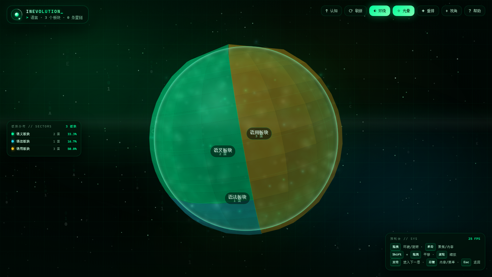
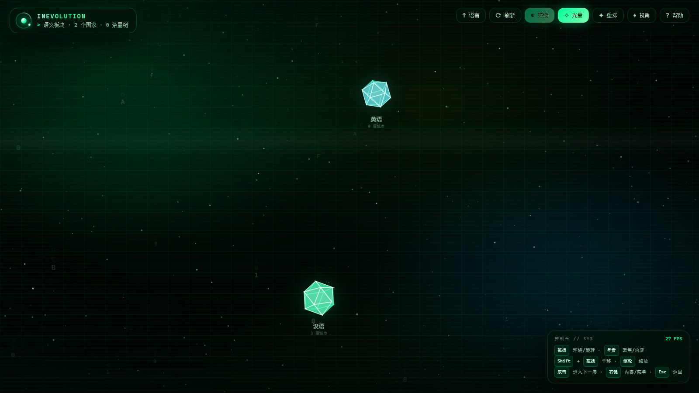
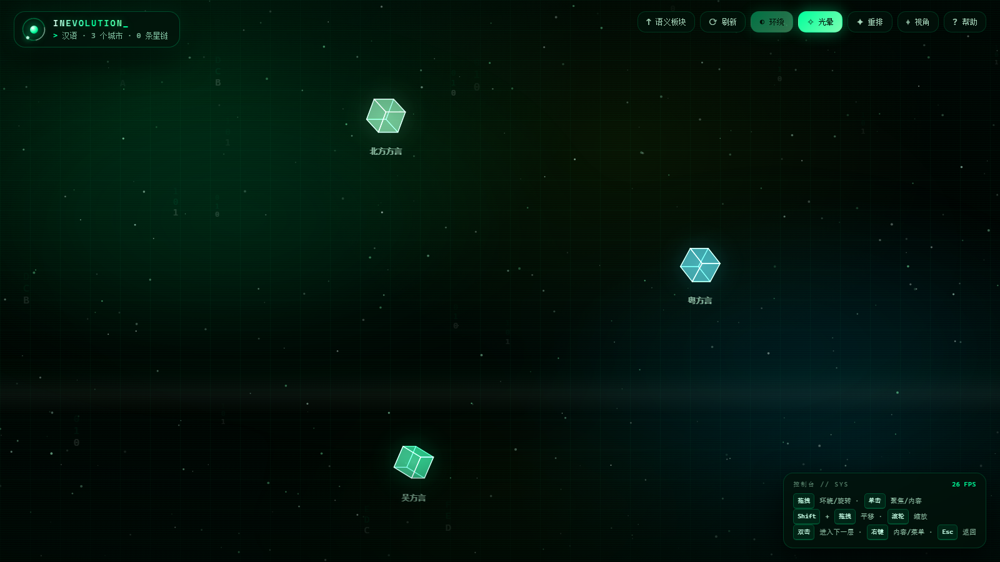
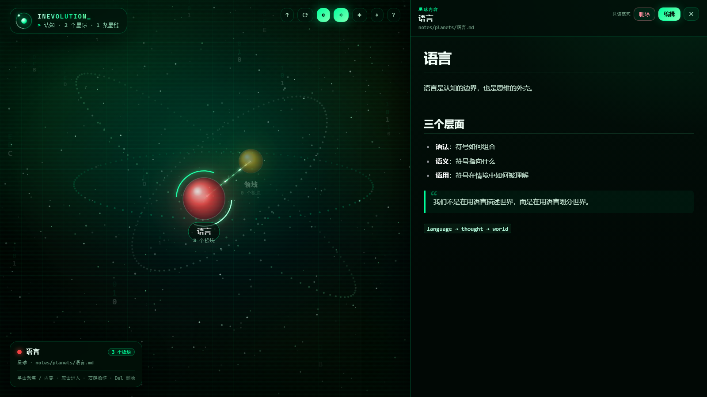
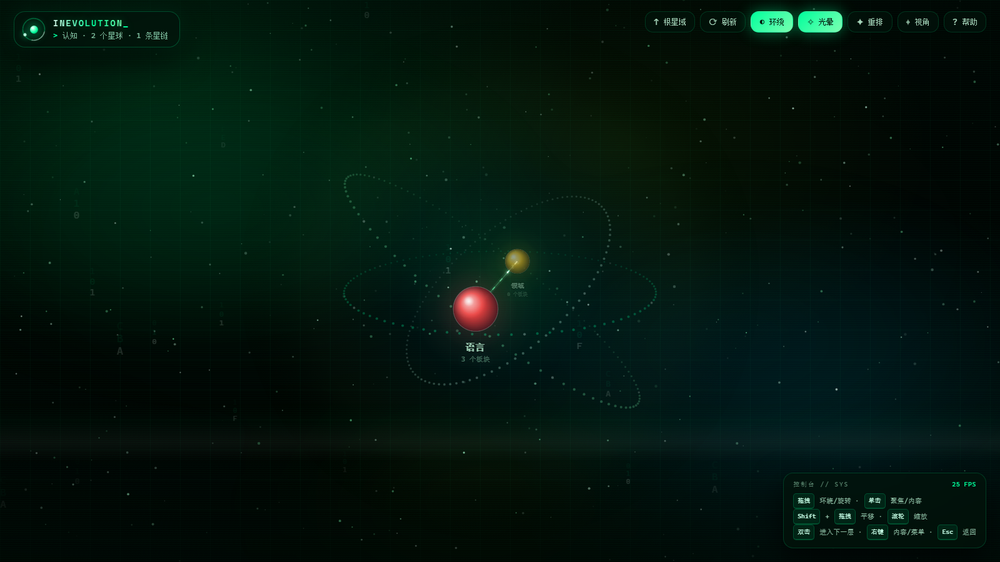
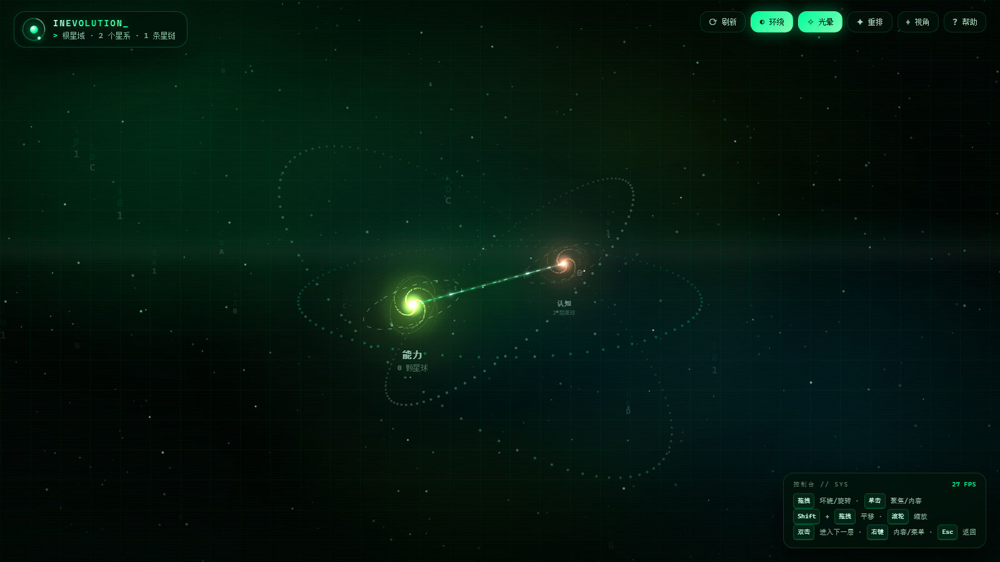

# INEvolution · 进化论

> 一个本地运行的 3D 知识笔记：**星系 → 星球 → 板块 → 国家 → 城市**。  
> 节点不再是 Markdown 文件的映射；内容在需要时生成，并在右侧内容面板中读写。


<p align="center">
  
  
  
  
</p>

## 特性

- **五级节点树**：星系 → 星球 → 板块 → 国家 → 城市；每一级都可以独立创建、命名、配色与连星链。
- **节点与内容解耦**：星球不再代表某个 `.md` 文件。节点先存在，右键「编辑内容」时才创建对应的 Markdown 文件，并把规范路径写入节点。
- **单击聚焦 + 右侧内容面板**：如果节点已有内容文件，左侧聚焦节点，右侧展开 Markdown 阅读/编辑面板；没有内容时只聚焦。
- **内容删除与快捷键删除**：右侧面板「删除」只删除当前 Markdown，节点保留；选中节点后按 `Delete` / `Backspace` 删除节点（有子节点时阻止，输入框内不触发）。
- **板块高斯泼溅球体**：双击星球放大进入板块页面。板块是分布在大球体表面的弯曲长方形，面积严格按子节点「国家」数量分配，并铺满整个球面；支持全方向自由旋转。
- **可见板块皆可点击**：点击命中基于球面可见网格，而不是板块中心；聚焦一个板块后仍可继续点击其他可见板块。
- **国家平面**：双击板块进入平面国家页面；国家节点是缓慢转动的 3D 规则多面体（正八面体 / 正二十面体），页面本身不环绕。
- **城市平面**：双击国家进入城市页面；城市节点是 3D 正方体。
- **完整持久化**：节点树、父级关系、颜色、坐标、星链、内容路径全部保存到 `data/graph.json`。
- **零构建、零第三方 Python 依赖**：一个 `server.py` + 原生 Canvas/CSS/JS。
- **原生可访问性**：尊重 `prefers-reduced-motion`。

## 视图

### 板块球体

双击星球进入。球体半径固定，板块面积 = 该板块国家数 / 总国家数 × 球面面积；左侧图例直接给出面积百分比。

- 使用四元数 trackball 旋转，可以向任意方向自由拖动，不再受俯仰角限制。
- 点击命中基于可见曲面网格；任意露出正面的板块区域都可以单击，包括被聚焦板块旁边的其他板块。
- 聚焦板块只高亮并暂停自动旋转，不会强制把球体转向该板块，因此可以继续点击其他板块。
- 板块边界使用细亮线与柔和辉光，不再有粗黑分隔线；表面增加方向光、边缘暗化、镜面高光与边缘光。



### 国家平面

双击板块进入。每个国家是一颗规则多面体，节点下方显示城市数量。



### 城市平面

双击国家进入。城市是 3D 正方体，层级在这里结束。



### 右侧内容面板

单击有内容的节点，左侧保留星图，右侧展开 Markdown。支持 GFM、代码高亮、阅读/编辑模式与 `Ctrl + S` 保存。



### 星系视图与根星域

<details>
  <summary>展开星系视图截图</summary>

  

  
</details>

> 截图使用一套示例数据（语义/语法/语用板块），用于展示层级与面积规则。

## 快速开始

要求：Python 3.9+（仅标准库）。

```bash
git clone <your-repo-url> INEvolution
cd INEvolution
python server.py
```

打开 <http://127.0.0.1:8080/>。

也可以指定地址和端口：

```bash
python server.py --host 0.0.0.0 --port 9000
# 或
KG_PORT=9000 python server.py
```

> `notes/` 里已有的内容不会自动变成节点。当前仓库中的 `notes/planets/语言.md`、`notes/planets/领域.md` 已经通过节点树关联到同名星球；新增节点需要在右键菜单中选择「编辑内容」才会生成内容文件。

## 项目结构

```text
INEvolution/
├── server.py                 # Python 标准库 HTTP 服务 + JSON API
├── web/
│   ├── index.html            # 页面结构、HUD、主题 CSS
│   └── app.js                # 树、相机、板块球体、国家/城市渲染、菜单与内容面板
├── notes/                    # 内容文件，按节点类型分目录
│   ├── planets/语言.md
│   ├── planets/领域.md
│   ├── galaxies/            # 右键星系「编辑内容」后按需创建
│   ├── sectors/             # 板块内容
│   ├── countries/           # 国家内容
│   └── cities/              # 城市内容
├── data/
│   └── graph.json            # 节点树、父子关系、颜色、坐标、星链、内容路径
├── docs/
│   ├── ARCHITECTURE.md       # 架构、树模型、球面面积算法、API
│   ├── USAGE.md              # 使用与快捷键
│   └── assets/               # README 截图
├── CHANGELOG.md
├── .gitignore
└── README.md
```

## 层级与内容

| 层级 | 父节点 | 子节点 | 页面形态 | 节点外观 |
| --- | --- | --- | --- | --- |
| 星系 | 根星域 | 星球 | 3D 图谱 | 螺旋星系 |
| 星球 | 星系 | 板块 | 3D 球体 | 球体 |
| 板块 | 星球 | 国家 | 3D 球体表面 | 弯曲长方形 |
| 国家 | 板块 | 城市 | 平面（固定正面相机） | 规则多面体 |
| 城市 | 国家 | — | 平面（固定正面相机） | 正方体 |

内容文件使用稳定 ID，而不是名称：

```text
notes/{galaxies|planets|sectors|countries|cities}/{safe-node-id}.md
```

重命名节点不会移动文件；节点的 `md` 字段写入 `data/graph.json`，形成规范依赖。内容文件不存在时，单击只聚焦；右键「编辑内容」会创建文件并打开编辑模式。

## 使用

| 操作 | 效果 |
| --- | --- |
| 拖拽空白 | 环绕图谱 / 拖动板块球体 |
| `Shift` + 拖拽 | 平移视角 |
| 滚轮 | 推近 / 拉远 |
| 单击节点 | 聚焦；如果已有内容，右侧打开内容面板 |
| 点击空白 / `Esc` | 关闭内容 → 取消聚焦 |
| 双击节点 | 放大进入下一层；城市为叶子节点，双击打开内容 |
| 右键节点 | 编辑内容 / 进入 / 新建子节点 / 重命名 / 配色 / 星链 / 删除 |
| 右键空白 | 新建当前层级节点 / 返回上一层 / 重排 / 重置视角 |
| `Esc` | 关闭浮层 → 关闭内容 → 取消聚焦 → 返回上一层 |
| `Delete` / `Backspace` | 删除当前选中节点（有子节点时阻止；输入框内不触发） |
| `Space` | 图谱自动环绕 / 板块球体自动旋转 |
| `R` | 重置视角 |

更完整的说明见 [docs/USAGE.md](docs/USAGE.md)。

## 数据与 API

- 内容文件：`notes/`（按类型分目录；支持子目录）
- 图数据：`data/graph.json`
- API：`/api/files`、`/api/meta`、`/api/content`、`/api/save`、`/api/create`、`/api/delete`

`/api/create` 推荐使用规范路径：

```json
{ "path": "sectors/s-xxxx.md", "content": "# 板块\n\n" }
```

也兼容旧的 `{ "name": "标题" }`（在 `notes/` 根目录创建）。

> 建议把 `notes/` 和 `data/graph.json` 一起备份。`data/graph.json` 是纯文本，可手动编辑。

数据树、球面面积算法与端点细节见 [docs/ARCHITECTURE.md](docs/ARCHITECTURE.md)。

## 自定义

- 主题色、扫描线、字体等集中在 `web/index.html` 的 `:root` 变量和 `HACKER / MATRIX THEME OVERRIDES` 区段。
- 星链数据流参数在 `web/app.js` 的 `drawLinks()` 中；板块弧线在 `drawSectorLinks()` 中。
- 板块配色在 `SECTOR_COLORS`，国家/城市调色板在 `COUNTRY_PALETTE` / `CITY_PALETTE`。
- 球体半径在 `SPLAT_RADIUS`；面积权重、树图布局与等面积投影在 `computeSectorPatches()` / `layoutTreemap()` / `sectorPoint()`。
- 布局写入 `data/graph.json`；拖拽节点后会自动保存。

## 技术栈

- **Frontend**：原生 JavaScript、Canvas 2D、CSS（无框架、无构建）
- **Markdown**：marked + DOMPurify + highlight.js（CDN；离线时自动降级）
- **Backend**：Python 标准库 `http.server`
- **Storage**：本地 JSON + Markdown 文件
- **板块球体**：Canvas 2D 高斯泼溅风格近似（缓存 splat 纹理 + 动态粒子 + 等面积球面矩形），不使用 WebGL/3DGS 库

## 文档

- [架构与 API](docs/ARCHITECTURE.md)
- [使用指南](docs/USAGE.md)
- [更新日志](CHANGELOG.md)
